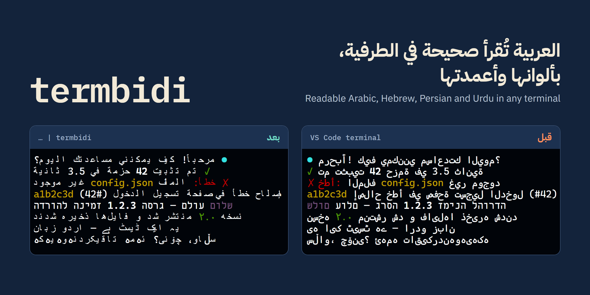
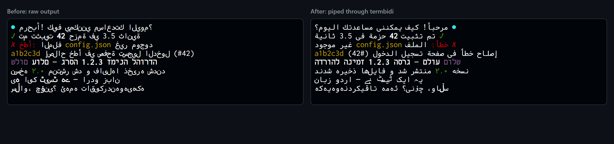
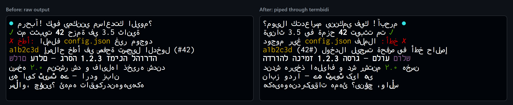

<div dir="rtl">

<p align="center">
  
</p>

<p align="center">
  <a href="https://github.com/yahyakhalid/termbidi/actions/workflows/ci.yml"></a>
  <a href="LICENSE"></a>
  
  <a href="docs/benchmarks.md#1-unicode-conformance"></a>
  
</p>

<p align="center"><a href="README.md">English</a> · <b>العربية</b></p>

<p align="center">
  <a href="https://github.com/topics/rtl"><code>#rtl</code></a>
  <a href="https://github.com/topics/arabic"><code>#arabic</code></a>
  <a href="https://github.com/topics/hebrew"><code>#hebrew</code></a>
  <a href="https://github.com/topics/persian"><code>#persian</code></a>
  <a href="https://github.com/topics/urdu"><code>#urdu</code></a>
  <a href="https://github.com/topics/kurdish"><code>#kurdish</code></a>
  <a href="https://github.com/topics/bidi"><code>#bidi</code></a>
  <a href="https://github.com/topics/unicode"><code>#unicode</code></a>
  <a href="https://github.com/topics/terminal"><code>#terminal</code></a>
  <a href="https://github.com/topics/cli"><code>#cli</code></a>
  <a href="https://github.com/topics/tui"><code>#tui</code></a>
  <a href="https://github.com/topics/ansi"><code>#ansi</code></a>
  <a href="https://github.com/topics/i18n"><code>#i18n</code></a>
  <a href="https://github.com/topics/nodejs"><code>#nodejs</code></a>
  <a href="https://github.com/topics/typescript"><code>#typescript</code></a>
</p>

# termbidi

**يجعل العربية والعبرية والفارسية والأردية والكردية مقروءة في الطرفيات التي لا تدعم الكتابة من اليمين إلى اليسار، دون أن تضيع الألوان أو يتغير عرض الأعمدة.**

## المشكلة

أغلب الطرفيات ترسم النص خانةً خانة من اليسار إلى اليمين. Windows Terminal وطرفية VS Code (المبنية على xterm.js) وWarp وGhostty لا تطبّق خوارزمية Unicode للنص ثنائي الاتجاه، فيظهر سطر مثل `✓ تم تثبيت 42 حزمة` بكلمات مقلوبة وحروف منفصلة. يتكرر هذا في كل سطر عربي يطبعه وكيل برمجة أو أداة اختبارات أو `git log`.

كل تطبيق اليوم يرقّع المشكلة وحده، أو يتركها:

- في Claude Code بلاغات مفتوحة عن النص المقلوب ([#89489](https://github.com/anthropics/claude-code/issues/89489))، وعن المشكلة المعاكسة: النص يُقلب مرتين في iTerm2 3.7 لأنه يرتّب النص بنفسه ([#99046](https://github.com/anthropics/claude-code/issues/99046)).
- Gemini CLI أغلق طلب دعم الاتجاه ثنائي النص في الطرفية دون خطة لتنفيذه ([#25478](https://github.com/google-gemini/gemini-cli/issues/25478)).
- طلب دمج لإضافة الدعم إلى Glow مفتوح منذ أبريل 2026 ([#923](https://github.com/charmbracelet/glow/pull/923))، وطلب المراجع فيه طريقة لاكتشاف الطرفيات التي تدعم الكتابة من اليمين أصلاً.
- الأدوات العامة مثل `fribidi` و`python-bidi` تعامل أكواد الألوان كأنها نص فتخرّبها.

## لمن هذه الأداة

- **لكل من يستخدم الطرفية بلغة تُكتب من اليمين**، ليقرأ المخرجات الممرَّرة إليها: `git log | termbidi`.
- **لمطوّري أدوات سطر الأوامر وواجهات الطرفية** (وكلاء البرمجة، عارضات markdown، أدوات السجلات) الذين يريدون دالة واحدة مختبرة بدلاً من كتابة حلهم الخاص.

## ماذا تفعل

| | |
|---|---|
| **ترتيب صحيح** | خوارزمية Unicode للنص ثنائي الاتجاه (UAX #9)، مع بقاء الكلمات الإنجليزية والأرقام والمسارات بترتيب قراءتها، وعكس الأقواس |
| **الألوان تبقى** | كل حرف يحتفظ بلونه وتنسيقه (ANSI) وروابط OSC 8 |
| **حروف عربية متصلة** | تتحول حروف العربية والفارسية والأردية والكردية إلى أشكالها المتصلة، لأن الطرفيات التي ترسم خانةً خانة لا تستطيع وصلها |
| **العرض نفسه** | السطر يأخذ عدد الأعمدة نفسه قبل التحويل وبعده، فتبقى الجداول والحدود في مكانها |
| **تعرف طرفيتك** | لا تلمس النص في الطرفيات التي تتعرّف عليها وتعرف أنها ترتّب العربية بنفسها (iTerm2 3.7 وما بعده، mintty، Konsole، VTE)، فلا ينقلب النص فيها مرتين |
| **آمنة افتراضياً** | الأسطر التي ليس فيها نص من اليمين لليسار، والتي تحرّك المؤشر، والتي فيها أكواد تحكم مشوّهة، تمر كما هي دون أي تغيير، والتنسيق يُعاد بناؤه من معاملات ألوان معروفة فقط |

## لقطات

مخرجات حقيقية في xterm.js 6 بمحرك WebGL، وهو المحرك الذي تعمل عليه طرفية VS Code. اليسار: النص كما يُطبع. اليمين: النص نفسه بعد تمريره عبر termbidi.

<p align="center"></p>

لماذا وصل الحروف مفعّل افتراضياً: مع إعادة الترتيب وحدها (`--no-shape`) تأتي الكلمات بترتيبها الصحيح، لكن الحروف العربية تبقى منفصلة.

<p align="center"></p>

## جرّبها

تحتاج Node.js 18 أو أحدث. لا تثبيت، ولا اتصال بالإنترنت أثناء العمل.

```bash
npx github:yahyakhalid/termbidi --demo
```

مرّر أي أمر عبرها:

```bash
cat notes-ar.md | npx github:yahyakhalid/termbidi
git -c color.ui=always log --oneline | npx github:yahyakhalid/termbidi
```

أو ثبّتها:

```bash
npm install -g github:yahyakhalid/termbidi
some-command | termbidi --width auto --align-rtl
```

> أدوات كثيرة تطفئ ألوانها عند التمرير عبر pipe. اطلبها صراحة: `git -c color.ui=always` أو `FORCE_COLOR=1 npm test` أو `ls --color=always`.

### خيارات سطر الأوامر

| الخيار | ماذا يفعل |
|---|---|
| `-w, --width <n\|auto>` | يلفّ الأسطر على `n` عموداً **قبل** إعادة الترتيب، فتُقرأ الأسطر العربية الطويلة من الأعلى إلى الأسفل |
| `-r, --align-rtl` | مع `--width`، يحاذي الأسطر العربية إلى اليمين |
| `-d, --dir <auto\|ltr\|rtl>` | الاتجاه الأساسي لكل سطر (الافتراضي: من أول حرف قوي) |
| `--no-shape` | لا يصل الحروف العربية (للطرفيات التي تصلها بنفسها) |
| `--ligatures` | يدمج اللام والألف في خانة واحدة (يغيّر عرض السطر) |
| `-f, --force` | يرتّب النص حتى لو بدا أن الطرفية ترتّبه بنفسها |
| `--detect` | يطبع الطرفية التي تعرّف عليها وما سيفعله |

## الفرق عن البدائل

| | تحافظ على ألوان ANSI | لفّ حسب عرض الأعمدة | وصل الحروف العربية | تعرف الطرفيات التي ترتّب بنفسها | مكتبة لتطبيقات Node |
|---|---|---|---|---|---|
| **termbidi** | ✅ | ✅ | ✅ | ✅ | ✅ |
| `fribidi` (سطر أوامر) | ❌ لا يتعامل معها | ❌ | ✅ | ❌ | ❌ (مكتبة C) |
| `python-bidi` | ❌ بقيت الأكواد سليمة في سطر واحد من 55 | ❌ | ❌ | ❌ | ❌ (Python) |
| `bidi-js` | ❌ | ❌ | ❌ | ❌ | ✅ (الخوارزمية فقط، وtermbidi يستخدمها) |
| ترقيعات داخل التطبيقات (Claude Code وPi وطلب Glow) | يختلف | يختلف | يختلف | قوائم ثابتة | ❌ غير قابلة لإعادة الاستخدام |

الأرقام مقيسة، وطريقة إعادة قياسها في [docs/benchmarks.md](docs/benchmarks.md). ضمن المصادر وعبارات البحث التي وثّقناها، لم نعثر على مكتبة أخرى تجمع هذه القدرات الخمس.

## استخدمها في تطبيقك

```bash
npm install github:yahyakhalid/termbidi
```

<div dir="ltr">

```js
import { forTerminal, toVisual, createVisualStream, detect } from 'termbidi';

// Converts only when the current terminal needs it.
process.stdout.write(forTerminal('\x1b[32m✓\x1b[0m تم تثبيت 42 حزمة\n'));

// Always convert, with options.
toVisual('שלום (world)', { width: 40, alignRtl: true });

// Streaming: converts complete lines as they arrive.
child.stdout.pipe(createVisualStream()).pipe(process.stdout);

// What was decided, and why.
detect(); // { mode: 'reorder', shape: true, terminal: 'Windows Terminal', reason: '...' }
```

</div>

التطبيقات التي تملك الشاشة كاملة (Ink وblessed وما يشبهها) تستدعي `toVisual()` على كل سطر **بعد** تحديد عرضه و**قبل** كتابته، لأن الـ pipe لا يستطيع إصلاح نص وُضع في مكانه بأوامر تحريك المؤشر. أمثلة أكثر في [`examples/`](examples/).

### الواجهة البرمجية

| الدالة | ماذا تعيد |
|---|---|
| `toVisual(text, options?)` | النص بترتيب العرض. الخيارات: `direction` و`shape` (افتراضياً `true`) و`ligatures` و`width` و`alignRtl` و`tabSize` |
| `lineToVisual(line, carry?, options?)` | سطراً واحداً مع حالة التنسيق في نهايته، لمن يكتب حلقة الأسطر بنفسه |
| `createVisualStream(options?)` | تيار `Transform` في Node |
| `forTerminal(text, options?, env?)` | `toVisual` إذا كانت الطرفية تحتاجه، وإلا النص كما هو |
| `detect(env?)` | `{ mode, shape, terminal, reason }` من متغيرات البيئة |
| `queryTerminal({ timeout? })` | يسأل الطرفية عن وضع الاتجاه ثنائي النص (DECRQM، الوضع 8): `implicit` أو `explicit` أو `unsupported` أو `no-answer` |
| `DISABLE_TERMINAL_BIDI` / `ENABLE_TERMINAL_BIDI` | `CSI 8 l` و`CSI 8 h` للطرفيات التي تدعم BDSM |

## كيف تعمل

1. تفصل كل سطر إلى نص وأكواد تحكم، وتحفظ تنسيق كل حرف.
2. تقسم النص إلى عناقيد حروف، فتبقى الحركات والرموز التعبيرية سليمة.
3. تحسب مستويات الاتجاه بخوارزمية Unicode (عبر `bidi-js`).
4. تصل حروف العربية بأشكالها المتصلة والنص ما زال بترتيبه المنطقي.
5. تلفّ السطر على العرض المطلوب، ثم ترتّب كل سطر عرض (قاعدتا UAX #9: ‏L1 وL2) وتعكس الأقواس.
6. تكتب الحروف من جديد بأقل عدد من أكواد التحكم يعيد لكل حرف تنسيقه.

## نتائج تحقّقنا منها

| الفحص | النتيجة |
|---|---|
| ملف Unicode الرسمي `BidiCharacterTest` إصدار 18.0 | **91,690 / 91,690** حالة (17 استُبعدت عمداً) |
| كل حرف يحتفظ بلونه (مدوّنة من 57 سطراً مختلطاً، كل كلمة بلون) | **57 / 57** سطراً |
| عرض الأعمدة لم يتغير | **57 / 57** سطراً |
| السرعة، وكل كلمة ملونة | نحو 29,000 سطر في الثانية على حاسوب مكتبي |

طريقة إعادة كل رقم: [docs/benchmarks.md](docs/benchmarks.md).

## القيود الحالية

- **تجريبية (0.1).** قد تتغير الواجهة البرمجية قبل الإصدار 1.0.
- **كشف الطرفيات غير مؤكد كله.** تحققنا على الشاشة من xterm.js (طرفية VS Code) فقط. التفاصيل في [docs/terminals.md](docs/terminals.md)، ونرحب بتقرير عن طرفيتك.
- **الأسطر التي تحرّك المؤشر تمر كما هي.** أشرطة التقدم والتطبيقات التي تملأ الشاشة تحتاج المكتبة، لا الـ pipe.
- **آخر سطر غير مكتمل ينتظر نهايته** في التيار وفي سطر الأوامر، فالنص الذي يصل كلمة كلمة يظهر سطراً سطراً.
- **وصل الحروف يعتمد على الخط.** إذا لم يحتوِ خط الطرفية (أو الخط الاحتياطي) على أشكال الحروف العربية، ستظهر فراغات أو مربعات.
- **حساب العرض مبسّط.** الحركات صفر أعمدة، والحروف الآسيوية العريضة والرموز التعبيرية عمودان، والباقي عمود واحد.

## الخطوات القادمة

- تأكيد جدول الطرفيات بتقارير من مستخدمي iTerm2 وKonsole وmintty وApple Terminal.
- خيار في سطر الأوامر يستخدم `queryTerminal()` مع الطرفيات التي تجيب عن DECRQM.
- مكوّن لـ Ink وأمثلة لمكتبات واجهات الطرفية المعروفة.
- نسخ لـ Go ‏(lipgloss/glamour) وRust ‏(ratatui)، حيث توجد اليوم الترقيعات نفسها.

## المساهمة

أكثر ما يساعد: تقرير من طرفية حقيقية. شغّل `--detect` و`--demo` وأرفق لقطة شاشة. التفاصيل في [CONTRIBUTING.md](CONTRIBUTING.md)، والمشكلات الأمنية في [SECURITY.md](SECURITY.md).

## الرخصة

[MIT](LICENSE) © يحيى خالد. تستخدم [bidi-js](https://github.com/lojjic/bidi-js) (رخصة MIT).

</div>
