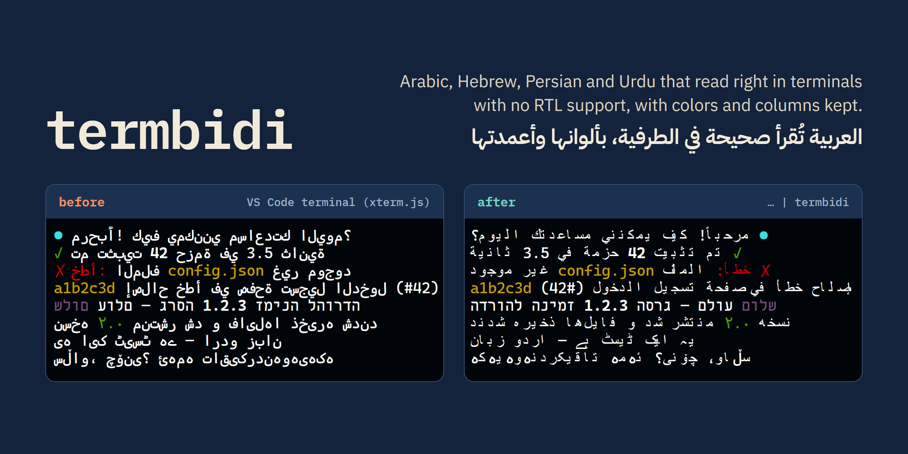

<p align="center">
  
</p>

<p align="center">
  <a href="https://github.com/yahyakhalid/termbidi/actions/workflows/ci.yml"></a>
  <a href="LICENSE"></a>
  
  <a href="docs/benchmarks.md#1-unicode-conformance"></a>
  
</p>

<p align="center"><b>English</b> · <a href="README.ar.md">العربية</a></p>

# termbidi

**Make Arabic, Hebrew, Persian, Urdu and Kurdish readable in terminals that don't support right-to-left text, without losing ANSI colors or column widths.**

## The problem

Most terminals draw text cell by cell, left to right. Windows Terminal, the VS Code terminal (xterm.js), Warp and Ghostty do not apply the Unicode Bidirectional Algorithm, so a line like `✓ تم تثبيت 42 حزمة` comes out with its words reversed and its letters disconnected. It happens in every line an AI coding agent, a test runner or `git log` prints in an RTL language.

Each app currently patches this on its own, or not at all:

- Claude Code has open reports for reversed text ([#89489](https://github.com/anthropics/claude-code/issues/89489)) and for the opposite problem, text flipped twice in iTerm2 3.7, which reorders by itself ([#99046](https://github.com/anthropics/claude-code/issues/99046)).
- Gemini CLI closed its request for terminal BiDi support with no plans to add it ([#25478](https://github.com/google-gemini/gemini-cli/issues/25478)).
- A BiDi pull request for Glow has been open since April 2026 ([#923](https://github.com/charmbracelet/glow/pull/923)), and its reviewer asked for a way to detect terminals that already handle RTL.
- Plain BiDi tools such as `fribidi` and `python-bidi` treat color codes as text and scramble them.

## Who it's for

- **People who use the terminal in an RTL language**, to read piped output: `git log | termbidi`.
- **Authors of CLI and TUI tools** (agents, markdown viewers, loggers) who want one tested function instead of writing their own.

## What it does

| | |
|---|---|
| **Correct order** | The Unicode Bidirectional Algorithm (UAX #9), with English words, numbers and paths kept in reading order and brackets mirrored |
| **Colors kept** | Every character keeps its own ANSI color, bold and OSC 8 hyperlink |
| **Joined Arabic letters** | Arabic, Persian, Urdu and Kurdish letters are converted to their joined forms, because cell-by-cell renderers can't join them |
| **Same width** | A line takes the same number of columns before and after, so tables and borders stay aligned |
| **Terminal-aware** | Leaves text alone in the terminals it recognises as reordering RTL themselves (iTerm2 ≥ 3.7, mintty, Konsole, VTE), so the text is not flipped twice there |
| **Safe by default** | Lines without RTL text, lines with cursor movement and lines with malformed escape sequences pass through byte for byte; styles are rebuilt from known SGR parameters only |

## Try it

You need Node.js 18 or newer. No install, no network calls at runtime.

```bash
npx github:yahyakhalid/termbidi --demo
```

Pipe any command through it:

```bash
cat notes-ar.md | npx github:yahyakhalid/termbidi
git -c color.ui=always log --oneline | npx github:yahyakhalid/termbidi
```

Or install it:

```bash
npm install -g github:yahyakhalid/termbidi
some-command | termbidi --width auto --align-rtl
```

> Many tools turn their colors off when piped. Ask for them: `git -c color.ui=always`, `FORCE_COLOR=1 npm test`, `ls --color=always`.

### CLI options

| Option | What it does |
|---|---|
| `-w, --width <n\|auto>` | Wrap to `n` columns **before** reordering, so long RTL lines read top to bottom |
| `-r, --align-rtl` | With `--width`, right-align lines whose base direction is RTL |
| `-d, --dir <auto\|ltr\|rtl>` | Base direction of each line (default: from the first strong character) |
| `--no-shape` | Don't join Arabic letters (for terminals that already shape Arabic) |
| `--ligatures` | Join lam + alef into one cell (changes column widths) |
| `-f, --force` | Reorder even if the terminal seems to do it itself |
| `--detect` | Print which terminal was recognised and what termbidi will do |

## How it differs from the alternatives

| | ANSI colors kept | Column-aware wrapping | Arabic joining | Knows which terminals reorder | Library for Node apps |
|---|---|---|---|---|---|
| **termbidi** | ✅ | ✅ | ✅ | ✅ | ✅ |
| `fribidi` (CLI) | ❌ not handled | ❌ | ✅ | ❌ | ❌ (C library) |
| `python-bidi` | ❌ codes intact in 1 of 55 test lines | ❌ | ❌ | ❌ | ❌ (Python) |
| `bidi-js` | ❌ | ❌ | ❌ | ❌ | ✅ (algorithm only; termbidi uses it) |
| In-app patches (Claude Code, Pi, Glow PR) | varies | varies | varies | fixed lists | ❌ not reusable |

Measured where a number is given; see [docs/benchmarks.md](docs/benchmarks.md). Within the sources and search terms we documented, we did not find another library that combines all five.

## Use it in your app

```bash
npm install github:yahyakhalid/termbidi
```

```js
import { forTerminal, toVisual, createVisualStream, detect } from 'termbidi';

// Converts only when the current terminal needs it (reads TERMBIDI and the
// terminal's environment variables).
process.stdout.write(forTerminal('\x1b[32m✓\x1b[0m تم تثبيت 42 حزمة\n'));

// Always convert, with options.
toVisual('שלום (world)', { width: 40, alignRtl: true });

// Streaming: converts complete lines as they arrive.
child.stdout.pipe(createVisualStream()).pipe(process.stdout);

// What was decided, and why.
detect(); // { mode: 'reorder', shape: true, terminal: 'Windows Terminal', reason: '...' }
```

Full-screen apps that own the screen (Ink, blessed, ratatui-style renderers) should call `toVisual()` on each line **after** they decide its width and **before** writing it, because a pipe can't fix text that has already been positioned with cursor movement. More examples are in [`examples/`](examples/).

### API

| Function | Returns |
|---|---|
| `toVisual(text, options?)` | Text in visual order. Options: `direction`, `shape` (default `true`), `ligatures`, `width`, `alignRtl`, `tabSize` |
| `lineToVisual(line, carry?, options?)` | One line plus the style state at its end, for your own line loop |
| `createVisualStream(options?)` | A Node `Transform` stream |
| `forTerminal(text, options?, env?)` | `toVisual` when the terminal needs it, otherwise the text unchanged |
| `detect(env?)` | `{ mode, shape, terminal, reason }` from environment variables |
| `queryTerminal({ timeout? })` | Asks the terminal for its BiDi mode (DECRQM, mode 8): `implicit`, `explicit`, `unsupported` or `no-answer` |
| `DISABLE_TERMINAL_BIDI` / `ENABLE_TERMINAL_BIDI` | `CSI 8 l` / `CSI 8 h`, for terminals that support BDSM |

## How it works

1. Split each line into text and escape sequences, remembering the style of every character.
2. Split text into grapheme clusters, so combining marks and emoji stay whole.
3. Resolve embedding levels with the Unicode Bidirectional Algorithm (`bidi-js`).
4. Join Arabic-script letters into presentation forms while the text is still in logical order.
5. Wrap to the requested width, then reorder each display line (UAX #9 rules L1–L2) and mirror brackets.
6. Write the characters back with the minimum escape sequences needed to restore each one's style.

## Verified results

| Check | Result |
|---|---|
| Unicode `BidiCharacterTest` 18.0 | **91,690 / 91,690** cases (17 skipped by design) |
| Each character keeps its color (57-line mixed corpus, every word a different color) | **57 / 57** lines |
| Column width unchanged | **57 / 57** lines |
| Throughput, every word colored | ~29,000 lines/s on a desktop PC |

How to re-run every number: [docs/benchmarks.md](docs/benchmarks.md).

## Limitations

- **Experimental (0.1).** The API may change before 1.0.
- **Terminal detection is partly unverified.** Only xterm.js (VS Code) was checked on screen. See [docs/terminals.md](docs/terminals.md) and please report your terminal.
- **Lines with cursor movement are left as is.** Progress bars and full-screen apps need the library, not the pipe.
- **A partial last line waits for its newline** in the stream and CLI, so text streamed word by word shows up line by line.
- **Joined letters depend on your font.** Without Arabic presentation forms in the font or its fallback you'll see gaps or boxes.
- **Width counting is simplified.** Combining marks are 0 columns, East Asian wide characters and emoji 2, everything else 1.

## Roadmap

- Confirm the terminal table with reports from users of iTerm2, Konsole, mintty and Apple Terminal.
- Opt-in `queryTerminal()` in the CLI for terminals that answer DECRQM.
- An Ink component and examples for popular TUI libraries.
- Ports or bindings for Go (lipgloss/glamour) and Rust (ratatui), where the same patches exist today.

## Contributing

Reports from real terminals help most: run `--detect` and `--demo` and attach a screenshot. See [CONTRIBUTING.md](CONTRIBUTING.md). Security issues: [SECURITY.md](SECURITY.md).

## License

[MIT](LICENSE) © Yahya Khalid. Uses [bidi-js](https://github.com/lojjic/bidi-js) (MIT).
